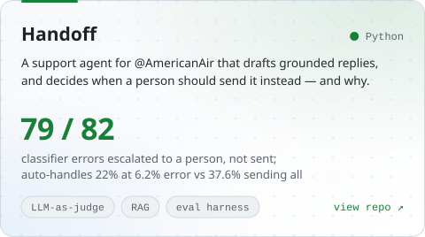
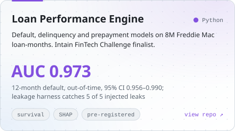
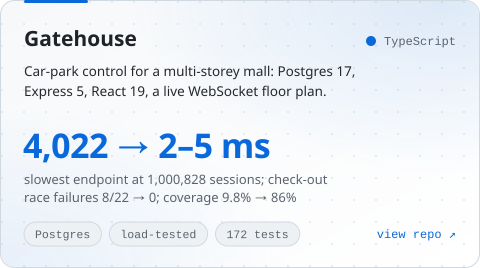
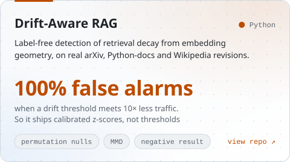
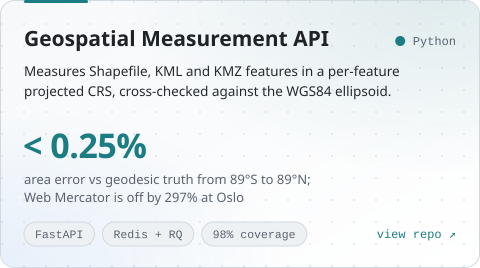
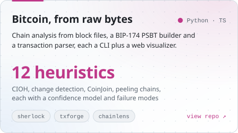

<picture>
  <source media="(prefers-color-scheme: dark)" srcset="./assets/hero-dark.svg">
  
</picture>

<!-- Commit resume.pdf to this repo, then uncomment. It is the link recruiters click first.

-->

**Every number on this page links to the file that produces it.** I build backend and distributed systems, and then the machinery that tries to break them. When a result doesn't survive that, the repo says so, and so does this page.

 

<picture>
  <source media="(prefers-color-scheme: dark)" srcset="./assets/rule-flagship-dark.svg">
  
</picture>

<a href="https://github.com/SuvidhJ/Raft_Consensus_Algorithm">
<picture>
  <source media="(prefers-color-scheme: dark)" srcset="./assets/raft-dark.svg">
  
</picture>
</a>

- **0 of 177,568** acknowledged writes lost across **200 forced leader crashes**, every key checked with no sampling. Writes resume in 353 ms median, 514 ms p99. The leader *process* is hard-killed each time, then restarted from its WAL · [`docs/BENCHMARKS.md`](https://github.com/SuvidhJ/Raft_Consensus_Algorithm/blob/main/docs/BENCHMARKS.md#1-leader-crash-failover-cmdfailover)
- **500 / 500** seeded chaos runs linearizable under [Porcupine](https://github.com/anishathalye/porcupine): 118,948 operations through 1,426 node crashes, 2,830 partitions and ~195k dropped messages · [`tests/chaos_test.go`](https://github.com/SuvidhJ/Raft_Consensus_Algorithm/blob/main/tests/chaos_test.go)
- **8 consensus bugs** caught by testing, all of which had passed the unit and integration suites: 3 by the chaos suite and 5 by the failover benchmark, including a State Machine Safety violation where a restarted ex-leader applied uncommitted entries. Each is pinned by a regression test. The fixes cut p99 recovery from **1,140 ms to 514 ms** and post-crash leader churn from **38% to 0%** · [`docs/CORRECTNESS.md`](https://github.com/SuvidhJ/Raft_Consensus_Algorithm/blob/main/docs/CORRECTNESS.md#bugs-the-failover-benchmark-caught)

<b>The bug worth reading:</b> a livelock that unit and integration tests couldn't see

 

A node rejected pre-votes while it believed a leader was alive: `leader != 0 && now < electionDeadline`. But every node resets its *own* deadline after a failed pre-vote. After certain partition sequences, every node stayed a follower and took turns failing pre-vote against the others' freshly reset deadlines. The result was no leader, indefinitely. Unit and integration suites passed clean; only the chaos harness found it. The fix anchors rejection to the last *genuine* contact from a leader, not to a deadline the node moves itself.

 

<picture>
  <source media="(prefers-color-scheme: dark)" srcset="./assets/rule-work-dark.svg">
  
</picture>

<table>
<tr>
<td width="50%" valign="top">
<a href="https://github.com/SuvidhJ/Handoff"><picture><source media="(prefers-color-scheme: dark)" srcset="./assets/card-handoff-dark.svg"></picture></a>
<b>Evidence</b> · <a href="https://github.com/SuvidhJ/Handoff/blob/main/reports/REPORT.md">REPORT.md</a> · <a href="https://github.com/SuvidhJ/Handoff/blob/main/README.md#what-is-misleading-about-the-headline-number">what the headline hides</a> · <a href="https://suvidhj.github.io/Handoff/">live demo</a>
</td>
<td width="50%" valign="top">
<a href="https://github.com/SuvidhJ/Loan-Performance-Intelligence-Engine"><picture><source media="(prefers-color-scheme: dark)" srcset="./assets/card-lpie-dark.svg"></picture></a>
<b>Evidence</b> · <a href="https://github.com/SuvidhJ/Loan-Performance-Intelligence-Engine/blob/main/reports/model_card.md">model card</a> · <a href="https://github.com/SuvidhJ/Loan-Performance-Intelligence-Engine/blob/main/reports/explainability.md">confidence intervals</a> · <a href="https://github.com/SuvidhJ/Loan-Performance-Intelligence-Engine/tree/main/docs/decisions">decision register</a>
</td>
</tr>
<tr>
<td width="50%" valign="top">
<a href="https://github.com/SuvidhJ/gatehouse"><picture><source media="(prefers-color-scheme: dark)" srcset="./assets/card-gatehouse-dark.svg"></picture></a>
<b>Evidence</b> · <a href="https://github.com/SuvidhJ/gatehouse/blob/main/METRICS.md">METRICS.md</a>, with the "before" figures kept
</td>
<td width="50%" valign="top">
<a href="https://github.com/SuvidhJ/Drift-aware-RAG-Label-free-detection-of-retrieval-degradation"><picture><source media="(prefers-color-scheme: dark)" srcset="./assets/card-drift-rag-dark.svg"></picture></a>
<b>Evidence</b> · <a href="https://github.com/SuvidhJ/Drift-aware-RAG-Label-free-detection-of-retrieval-degradation/blob/main/STATUS.md">STATUS.md</a> · <a href="https://github.com/SuvidhJ/Drift-aware-RAG-Label-free-detection-of-retrieval-degradation/blob/main/FINDINGS.md">FINDINGS.md</a> · <code>python main.py transfer</code>
</td>
</tr>
<tr>
<td width="50%" valign="top">
<a href="https://github.com/SuvidhJ/Geospatial-file-measurement-API"><picture><source media="(prefers-color-scheme: dark)" srcset="./assets/card-geo-api-dark.svg"></picture></a>
<b>Evidence</b> · <a href="https://github.com/SuvidhJ/Geospatial-file-measurement-API#accuracy-validation">accuracy report</a> · <a href="https://github.com/SuvidhJ/Geospatial-file-measurement-API/blob/main/SECURITY.md">threat model</a>
</td>
<td width="50%" valign="top">
<a href="https://github.com/SuvidhJ/sherlock-chain-analysis"><picture><source media="(prefers-color-scheme: dark)" srcset="./assets/card-bitcoin-dark.svg"></picture></a>
<b>Evidence</b> · <a href="https://github.com/SuvidhJ/sherlock-chain-analysis/blob/main/APPROACH.md">APPROACH.md</a> · <a href="https://github.com/SuvidhJ/txforge">txforge</a> · <a href="https://github.com/SuvidhJ/chainlens-explorer">chainlens</a> · graded on hidden fixtures
</td>
</tr>
</table>

<b>More:</b> bytecode reverse-engineering, QUIC policing at HPE, an AI code reviewer, upstream work

 

- [**EvmPulse**](https://github.com/SuvidhJ/EvmPulse): EVM bytecode reverse-engineering without source. Disassembly, control-flow graphs, selector resolution, proxy and reentrancy detection. Analysis of 13 real contracts and a tool-vs-source walkthrough on USDT · [RESEARCH.md](https://github.com/SuvidhJ/EvmPulse/blob/main/RESEARCH.md)
- [**QUIC identification and policing**](https://github.com/SuvidhJ/QUIC_Identification_and_Policing_HPE_CPP), built in HPE's Career Preview Program. An XGBoost model over sliding-window flow features classifies mirrored traffic, and the results drive Open vSwitch HTB queues and OpenFlow drop rules on IP, port and SNI · [demo](https://drive.google.com/file/d/1E00MFvj-J8lbFSxvHHEGhii9fvGoAayh/view)
- [**Argus code reviewer**](https://github.com/SuvidhJ/AI_Code_Reviewer): multi-agent PR review with a verification pass against false positives. It learns from accept and reject feedback through Beta-Bernoulli calibration and ships with an eval corpus of trap cases · 339 deterministic tests
- [**Incident-triage**](https://github.com/SuvidhJ/Incident-triage): an OpenEnv benchmark where an agent triages SRE incidents to a severity, owner and root cause
- [**ASmap analysis**](https://github.com/SuvidhJ/ASMAP-Competency-Tests): a fresh ASmap from RPKI, IRR and Routeviews, diffed against a pinned baseline with Bitcoin Core's tooling
- **Upstream:** [quick-select date filters](https://github.com/QuoteVote/quotevote-monorepo/pull/263), merged into QuoteVote

 

<picture>
  <source media="(prefers-color-scheme: dark)" srcset="./assets/rule-record-dark.svg">
  
</picture>

A result is only worth something if the process could have produced a different one. These stay on record.

| | What went wrong | Where it's kept |
| :-: | :-- | :-- |
| ✗ | **A shipped column that ran backwards.** The loan engine's `confidence` output went into every submission row untested. Against a rule fixed in advance, it worked on one of four targets. On the other three it runs backwards: errors concentrate where the model agrees with itself, 6.7× on prepayment | [D37](https://github.com/SuvidhJ/Loan-Performance-Intelligence-Engine/blob/main/docs/decisions/D37-rules-and-confidence.md), one of [12 falsified claims](https://github.com/SuvidhJ/Loan-Performance-Intelligence-Engine/tree/main/docs/decisions) |
| ✗ | **Seven published numbers, withdrawn.** Drift-Aware RAG's "3.00× better than random" was a 3-seed artifact; at 30 seeds it is 1.09×, p = 0.39. Its headline "blind spot" turned out to predict damage at AUC 0.77. Both are refuted in the repo, not deleted | [STATUS.md §4](https://github.com/SuvidhJ/Drift-aware-RAG-Label-free-detection-of-retrieval-degradation/blob/main/STATUS.md#4-numbers-that-were-published-and-are-now-withdrawn) |
| ✗ | **A better number I didn't report.** Keeping a duplicated thread, quoting the best of five seeds and reporting accuracy instead of macro-F1 would have shown Handoff's classifier at 0.725, not 0.640. The harness runs both and prints the gap | [what the headline hides](https://github.com/SuvidhJ/Handoff/blob/main/README.md#what-is-misleading-about-the-headline-number) |
| ✗ | **Five rounds on the wrong axis.** A fixture copied loan age into the calendar column, so the "out-of-time" splits were age splits. It is now a structural control with a test | [controls](https://github.com/SuvidhJ/Loan-Performance-Intelligence-Engine#the-three-structural-controls) |
| ✗ | **433–515 duplicate ticket codes per million** in Gatehouse's first published version. Now zero, with the before figures still published | [METRICS.md](https://github.com/SuvidhJ/gatehouse/blob/main/METRICS.md) |

 

<picture>
  <source media="(prefers-color-scheme: dark)" srcset="./assets/rule-experience-dark.svg">
  
</picture>

| | | |
| :-- | :-- | :-- |
| **Datamatics** | 2026 | GraphRAG compliance assistant for the EU AI Act: LangGraph agents over a Neo4j knowledge graph |
| **Hewlett Packard Enterprise** · Career Preview Program | 2026 | QUIC flow identification and traffic policing with XGBoost and Open vSwitch |
| **SentinelGuard AI** · co-founder, founding engineer | 2024–25 | gRPC services on Kubernetes, observed with Prometheus and Grafana |
| **Myciti 360** | 2025 | YOLOv8 computer-vision pipeline at 97.1% precision |
| **S M Techno Consultants** | 2024–25 | Next.js frontend with SSR, tested with Jest and Playwright |

🏆 **1st of 100+ teams**, J.P. Morgan Code for Good 2025 · **Finalist**, Intain FinTech Challenge 2026 · **Head of Projects**, Mozilla Firefox Club VIT · **VIT Vellore**, B.Tech CSE 2027, CGPA 9.26

**Stack:** **Go** · **Python** · **C++** · **TypeScript** · Java · gRPC · Postgres · Redis · RabbitMQ · Docker · Kubernetes · AWS · Prometheus · PyTorch · scikit-learn · LangGraph · Neo4j

 

<b>Open to SDE internships and 2027 new-grad roles in systems, backend and ML infrastructure.</b> 
If your system has to stay correct when things go wrong, <a href="mailto:suvidh.jain3@gmail.com">let's talk</a>.

